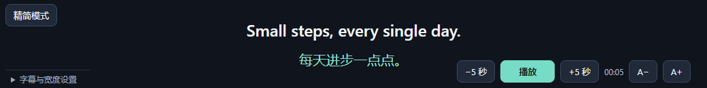

# Trancy 字幕浮窗

把 YouTube 上的字幕同步到独立置顶窗口，一边听英语，一边使用其他应用。优先显示 Trancy 双语字幕，未开启 Trancy 时自动使用 YouTube 自带字幕。

适用于桌面版 Chrome 116+，按 Trancy **7.9.4** 的字幕结构适配。**这是非官方扩展，与 Trancy 无隶属关系。**



*预览使用测试字幕。Chrome 自带的顶部网址栏未包含在预览中。*

## 下载与安装

**[下载 v1.4.0 安装包](https://github.com/keryze/trancy-floating-subtitles/raw/refs/heads/main/downloads/trancy-floating-subtitles-v1.4.0.zip)**

1. 下载并解压 ZIP，保留解压后的文件夹。
2. 在 Chrome 地址栏输入 `chrome://extensions`。
3. 开启右上角「开发者模式」，点击「加载已解压的扩展程序」。
4. 选择解压后包含 `manifest.json` 的文件夹。
5. 刷新 YouTube 视频页面；可以开启 Trancy 双语字幕，也可以使用 YouTube 自带字幕。
6. 点击页面左下角「字幕浮窗」，或在页面按 **Alt+Shift+S**。

如果下载的是整个仓库源码，加载其中的 **extension** 文件夹。

更新时替换原扩展文件夹中的文件，在扩展管理页点击重新加载，然后刷新 YouTube 并重新打开浮窗。

## 功能

- **自动选择字幕来源**：优先显示启用中的 Trancy；Trancy 未开启、隐藏或不存在时回退到 YouTube 自带字幕。恢复 Trancy 后自动切回双语，短暂空句不会混入其他字幕。
- **原生字幕**：进入原生模式时尝试开启 CC 一次；手动关闭后不会反复开启。跟随 YouTube 当前选择的字幕语言，显示在原文区域，不额外生成译文。
- 双语字幕居中显示，原文和译文分别调整字号（14–72 px）。
- **双语间距**：在左下角「字幕与宽度设置」中调节原文与译文的距离，范围 0–80 px，默认 12 px。
- **窗口宽度**：填写 240–1920 px 后点击「应用」，显示实际宽度；Chrome 自身的大小限制仍然生效。
- 暂停 / 继续播放，前后跳转 5 秒；焦点在字幕正文时，空格键也可控制播放。
- **A− / A+** 同时缩小或放大两行字幕。
- **精简模式**：鼠标移开后只显示字幕，移入后显示控件；字幕位置不跳动。支持 Tab 键唤出控件。
- 自动记住字号、双语间距、目标窗口宽度和精简模式。
- 默认布局：左上是精简模式，左下是字幕与宽度设置，右下是播放、时间与字号快捷按钮。

## 使用限制

- 视频需要有可用字幕。使用 YouTube 自带字幕无需安装 Trancy；显示双语字幕需要启用 Trancy。本扩展不生成或翻译字幕。
- 支持 `youtube.com` 和 `www.youtube.com`；不适用于 `learn.trancy.org` 学习中心。
- 普通双语字幕及旧版学习/阅读模式当前句均有适配。Trancy 更新页面结构后可能需要同步更新适配。
- 使用 Chrome 原生 Document Picture-in-Picture 置顶窗口。请保留 YouTube 标签页与 Chrome 进程；换视频后重新打开浮窗。
- Chrome 自带的顶部网址栏无法由此扩展隐藏；不支持透明桌面背景或鼠标穿透。
- Chrome 原生浮窗最大宽度约为屏幕宽度的 80%。1920 宽屏幕通常只能到约 1536，显示缩放会影响逻辑像素；填写 1920 无法解除浏览器限制。
- 依赖 Trancy 持续更新字幕。如果 Trancy 在后台停止更新，浮窗无法生成后续译文。

## 隐私与权限

- 唯一显式申请权限是 `storage`，用于保存字号、间距、目标宽度和模式。
- 内容脚本只注入 YouTube 的 HTTPS 页面，因此 Chrome 会提示对应网站访问权限。
- 不读取 Cookie、浏览历史或 Trancy 登录信息，不保存字幕正文。
- 无外部网络请求、远程字体、遥测或第三方脚本，不需要 API Key。
- 工具栏只查询当前标签页 ID 并发送扩展内部消息，不申请 `tabs` 权限。
- 不包含 Trancy 原始代码；字幕读取逻辑独立实现。

## 开发与验证

主要文件：

- `extension/reader.js`：Trancy 字幕 DOM 适配、英文分词和标点处理。
- `extension/content.js`：浮窗、精简模式、字号、字幕同步和播放控制。
- `extension/popup.*`：Chrome 工具栏入口。
- `tests/browser-test.cjs`：使用独立浏览器配置的集成测试。

31 项自动化检查已通过：包括原生字幕回退与来源切换、CC 自动开启及手动关闭、间距与宽度设置、字幕切换、节点重建、开放 Shadow DOM、当前句选取、广告期间清空、播放/暂停、字号保存、浮窗重开、精简模式悬停和键盘操作。测试使用模拟 Trancy DOM、真实 Chrome Document PiP 和原生媒体。

真实使用截图已确认能显示双语字幕。Windows 最小化后的持续同步仍未完成专门验证；Headless Chrome 的后台标签页测试不能代替这一验证。

测试需要 Node.js、Playwright 和桌面版 Chrome。可使用环境变量 `PLAYWRIGHT_MODULE` 指定 Playwright 模块位置，`CHROME_PATH` 指定 Chrome 可执行文件，然后运行：

```sh
node tests/browser-test.cjs
```

默认 Chrome 路径为 `C:/Program Files/Google/Chrome/Application/chrome.exe`。测试不使用个人 Chrome 配置文件，结果写入 `test-results/`。
